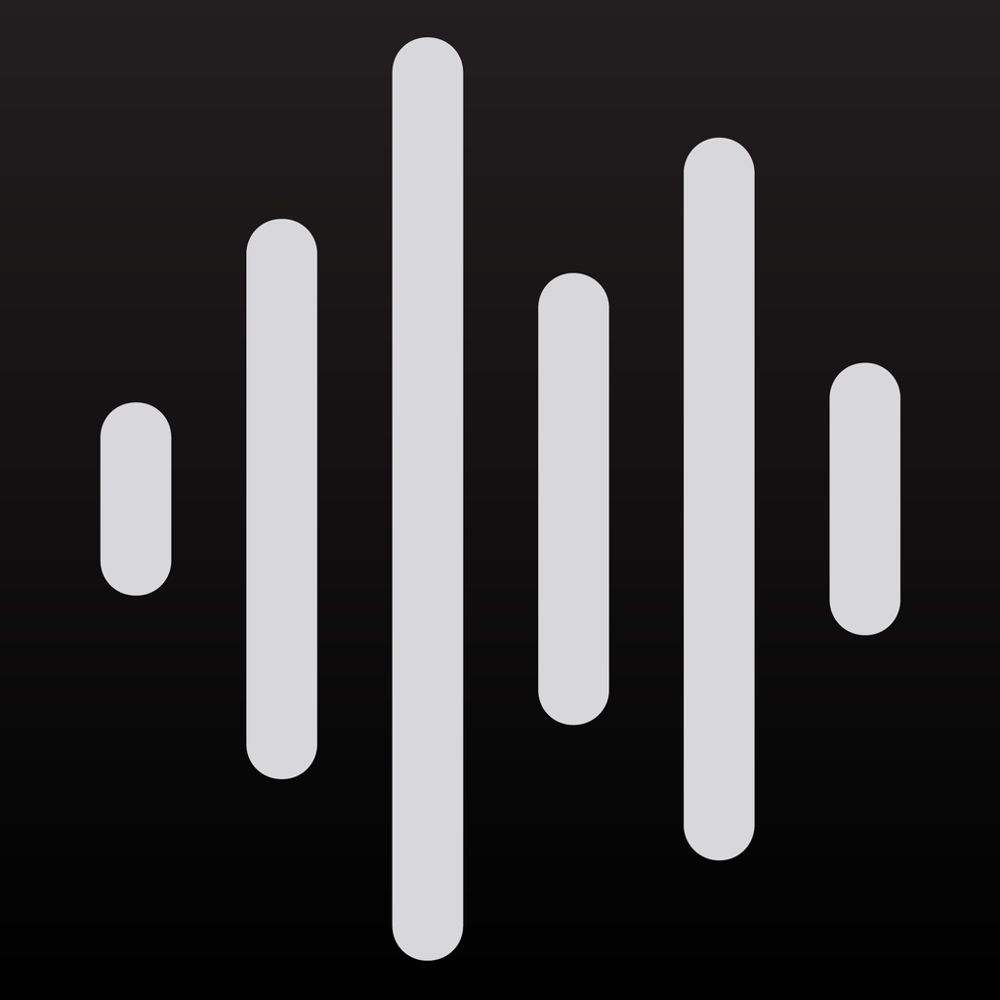

  

<h1 align="center">LiveDeck</h1>

  Multitrack recording and virtual soundcheck for live shows, on your Mac. 
  <a href="https://github.com/creativedamage/LiveDeck/releases/latest"><b>Download the latest version</b></a>

---

LiveDeck records every channel of your show from SoundGrid, Dante, MADI or any USB / Thunderbolt interface, and plays it back through the console for virtual soundcheck. It is built to keep recording no matter what: two disks at once, crash recovery, and an audio engine that never waits on the disk.

## Features

**Recording**
- Record up to 256 tracks to Broadcast WAV (24-bit or 32-bit float), ready for Pro Tools, Logic, Reaper and any DAW.
- Mono or stereo tracks: just pick a channel or a pair in the track's input menu.
- Record to two disks at the same time for a backup copy.
- Use several interfaces at once, for example Dante and MADI together.
- If the computer crashes or loses power, LiveDeck repairs the files when you reopen the session. Everything that reached the disk is kept.

**Timeline and playback**
- A timeline with coloured tracks and waveforms that draw live while you record.
- Click or drag anywhere to move the playhead, zoom in and out, and drop markers as the show goes.
- Play any take back through the console for virtual soundcheck: each track goes to its own output, in place of its live input.
- Drag WAV or AIFF files from Finder onto a track, or below the tracks to add new ones, then drag clips to wherever they belong. Undo is always one Cmd+Z away.

**Patching and tracks**
- Simple patching from each track's input and output menus, with mono and stereo options.
- **Mirror Input to Output** sends every track straight back out on the matching channel.
- Add, rename (Tab jumps to the next track), reorder by dragging, colour and delete tracks. Recordings follow their tracks.
- Save your layouts as templates and start every show from one.

**Control**
- OSC control with live feedback for Bitfocus Companion, TouchOSC and other controllers.
- MIDI Machine Control, plus MIDI Learn for the transport buttons.
- Keyboard shortcuts for everything you use during a show. Space never stops a recording.

**Always up to date**
- LiveDeck checks for new versions, shows you what's new, and installs the update for you. It never updates while you're recording or playing.

## Getting started

1. [Download LiveDeck](https://github.com/creativedamage/LiveDeck/releases/latest), open the `.dmg` and drag LiveDeck to Applications.
2. The first time, right-click LiveDeck and choose **Open** (it isn't notarized by Apple yet).
3. Create an account (email and password, Google or Microsoft), enter your organization's details, and choose a license.
4. Choose your interface in **Audio Setup** (Cmd+,).
5. **File > New Session** creates a show folder in **Documents > LiveDeck > Shows**, or anywhere you choose, such as an external SSD.
6. Add tracks with **+ Track**, arm them, and press **REC**.

## Pricing

| | Price | Includes |
| --- | --- | --- |
| **Annual** | $50 / year | All updates while active |
| **Perpetual** | $129 once | All updates |

Every license runs LiveDeck on **2 computers at a time on the same network**. Verified non-profits get **10% off** and pay no sales tax. Sign in with email and password or your Google or Microsoft account, register your organization, and buy in the app. LiveDeck checks your license when it starts and keeps working offline for up to 14 days.

## Requirements

- macOS on Apple Silicon or Intel.
- Any Core Audio interface. SoundGrid, Dante Virtual Soundcard and MADI interfaces all appear as Core Audio devices.
- A fast drive for recording. **Disks > Benchmark Disks** tells you if yours can keep up.

## Status

LiveDeck is new and still evolving. The engine is covered by automated tests, but test it with your own interfaces and drives before you rely on it at a show.

## Feedback and feature requests

Use **Help > Request a Feature**, **Report a Bug** or **Send Feedback** in the app, or [open an issue](https://github.com/creativedamage/LiveDeck/issues) here. See what's already been asked under [Issues](https://github.com/creativedamage/LiveDeck/issues).

## For developers

Building from source, releasing and how the engine works: see [docs/DEVELOPMENT.md](docs/DEVELOPMENT.md). Accounts and licensing setup: [docs/LICENSING.md](docs/LICENSING.md). What changed in each version: [CHANGELOG.md](CHANGELOG.md).
